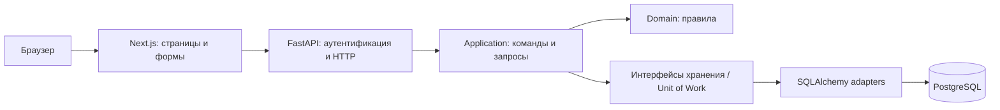

# TaskTracker — архитектура и план реализации

Статус: архитектурный план коммерческого продукта. Реализованная часть и фактические проверки описаны в корневом README.md. Ниже — целевая архитектура; наличие сценария в плане не означает его готовность.

## 1. Назначение

Личный трекер проектов и задач на Next.js + FastAPI. Преоекта цель: понять Server/Client Components, HTTP-контракты, серверную авторизацию, бизнес-сценарии, транзакции и размещение двух приложений.

MVP:

- регистрация, вход, выход и восстановление активной сессии;
- создание, переименование и архивирование собственных проектов;
- создание, редактирование, удаление задач и изменение статуса;
- статусы Todo, InProgress, Done;
- описание и календарная дата дедлайна;
- фильтрация, сортировка и пагинация;
- понятные состояния загрузки, отсутствия данных, ошибок и конфликтов;
- адаптивный интерфейс, управление клавиатурой, базовые проверки доступности;
- воспроизводимый локальный запуск, CI и публичный HTTPS-стенд.

За пределами MVP: команды и приглашения, совместное редактирование, роли администратора, realtime/WebSocket, вложения, уведомления, Telegram, offline-first. Их не реализовывать заранее.

## 2. Главное решение

Один репозиторий, один Next.js frontend, один модульный FastAPI backend, одна PostgreSQL. Это разделение frontend/backend; бизнес-часть остаётся монолитом, без микросервисов.



**Единственный источник бизнес-правил и доступа к БД — FastAPI backend.** В Next.js нет Prisma, SQLAlchemy, собственных таблиц сессий или альтернативной реализации прав доступа. Проверки frontend улучшают UX, но не заменяют backend.

## 3. Стек

| Часть | Выбор и назначение |
|---|---|
| Frontend | Next.js App Router, React, TypeScript |
| Формы | Нативные формы + useActionState; Zod для проверки ввода |
| Стили | CSS Modules + CSS variables; общие доступные UI-примитивы |
| Backend | Python, FastAPI, Pydantic, pydantic-settings |
| Данные | PostgreSQL, SQLAlchemy 2 AsyncSession, asyncpg |
| Миграции | Alembic |
| Пароли | Argon2id через поддерживаемую библиотеку, например pwdlib с Argon2 |
| HTTP-контракты | OpenAPI FastAPI; генерируемые TypeScript-типы, например openapi-typescript |
| Проверки | pytest, HTTPX, frontend unit tests, Playwright |
| Качество | ESLint, tsc, Ruff, проверка Python-типов |
| Запуск | Node.js runtime + Python ASGI runtime; Docker Compose для полного стенда |

При создании проекта выбрать поддерживаемые версии и зафиксировать зависимости в lock-файлах. Таблица объясняет назначения пакетов и не является командой установить всё сразу. Redis, очереди, глобальный state manager и DI-контейнер для MVP не нужны.

Next.js используется с серверным runtime. `output: 'export'` не подходит выбранным Server Actions и серверной работе с сессией. Отдельный FastAPI не делает серверные возможности Next.js статическими.

## 4. Структура репозитория

```text
TaskTracker/
  README.md
  .gitignore
  .env.example
  compose.yaml
  .github/workflows/ci.yml

  frontend/
    package.json
    package-lock.json
    next.config.ts
    src/
      app/
        layout.tsx
        (public)/login/page.tsx
        (public)/register/page.tsx
        (workspace)/layout.tsx
        (workspace)/projects/page.tsx
        (workspace)/projects/[projectId]/page.tsx
        (workspace)/projects/[projectId]/loading.tsx
        (workspace)/projects/[projectId]/error.tsx
        api/auth/login/route.ts
        api/auth/register/route.ts
        api/auth/logout/route.ts
      features/
        tasks/
          ui/task-list.tsx
          ui/task-card.tsx
          ui/task-form.tsx
          ui/task-filters.tsx
          server/actions.ts
          server/queries.ts
          contracts/input-schema.ts
        projects/
          ui/
          server/
          contracts/
        auth/
          ui/
          server/session.ts
      shared/
        ui/
        server/backend-client.ts
        contracts/api.generated.ts
    tests/
    e2e/

  backend/
    pyproject.toml
    uv.lock
    alembic.ini
    migrations/
    src/tasktracker/
      main.py
      bootstrap.py
      api/
        dependencies.py
        errors.py
        routers/auth.py
        routers/projects.py
        routers/tasks.py
        schemas/
      application/
        auth/
        projects/
        tasks/create_task.py
        tasks/update_task.py
        tasks/change_task_status.py
        tasks/list_project_tasks.py
        ports/unit_of_work.py
        ports/task_repository.py
        ports/project_repository.py
        ports/task_queries.py
        common/actor.py
        common/errors.py
      domain/
        tasks/task.py
        tasks/status.py
        projects/project.py
        errors.py
      infrastructure/
        db/engine.py
        db/models.py
        db/unit_of_work.py
        db/task_repository.py
        db/project_repository.py
        db/task_queries.py
        security/passwords.py
        security/sessions.py
        settings.py
    tests/unit/
    tests/integration/
```

Это ориентир: создавать файлы по мере реализации сценариев, не заводить пустые абстракции ради структуры. Каталог `backend/src/tasktracker` оформляется устанавливаемым Python-пакетом; импорты абсолютные от `tasktracker`.

## 5. Слои backend и правила импортов

| Слой | Ответственность | Чего здесь нет |
|---|---|---|
| API | APIRouter, Pydantic HTTP-схемы, зависимости, коды ответа | SQL и бизнес-расчёты |
| Application | Сценарии, Actor, команды/запросы, порты хранения | FastAPI Request/Depends/HTTPException, ORM-модели |
| Domain | Обычные Python-типы, enum, dataclass и бизнес-переходы | FastAPI, SQLAlchemy, cookies и HTTP |
| Infrastructure | SQLAlchemy, пароли, сессии, настройки | JSX и решение, что показывать на странице |
| Bootstrap | Соединение конкретных реализаций с интерфейсами | Бизнес-правила |

Application зависит от Domain и объявленных им самим портов. Infrastructure реализует порты Application. API получает готовые сценарии через функции зависимостей. Достаточно typing.Protocol и конструкторов/функций; универсальный DI-контейнер не нужен.

Не отдавать ORM-объекты наружу и не использовать одну модель одновременно как таблицу, HTTP-вход и публичный ответ. Публичные DTO содержат только необходимые поля. Python-сценарии возвращают обычные результаты; API отображает их в Pydantic response schemas.

## 6. Роль Next.js

Next.js отвечает за маршруты, SSR, layouts, формы, loading/error/empty states и тонкий Backend for Frontend.

- Страница читает данные через server-only backend-client напрямую из FastAPI.
- Не выполнять из Server Component HTTP-запрос к собственному Next.js Route Handler, который затем вызывает FastAPI: это лишний переход.
- Client Components используются для ввода, диалогов, интерактивного состояния и браузерных API.
- Server Actions вызывают FastAPI для изменений и обновляют соответствующие маршруты через revalidatePath.
- Route Handlers применяются для auth-моста, устанавливающего/удаляющего cookie в браузере. Не создавать дублирующий CRUD задач одновременно в actions и route handlers без потребности.
- `'use client'` ставится на небольшие интерактивные части, а не на весь root layout.
- `'use server'` не заменяет авторизацию. Каждый вызов в конечном итоге проверяется FastAPI.
- server-only защищает модули с приватным API URL, cookies и серверными запросами от случайного импорта в client bundle.
- Бизнес-правила не копируются на TypeScript. Валидация формы может дублировать простые ограничения ради удобства.

Состояние: форма и диалог — локально; фильтры/сортировка/страница — в URL; задачи — серверные данные. TanStack Query подключать только при реальной потребности в polling или сложном клиентском кеше. Не держать второй полный список задач в глобальном store параллельно серверному источнику.

## 7. Сессия и граница доверия

Для браузерного MVP выбрать серверные opaque sessions. JWT не обязателен.

1. FastAPI проверяет логин/пароль и создаёт случайный токен сессии минимум из 32 криптографически случайных байт.
2. В PostgreSQL сохраняется только хеш токена, user_id, срок и отметка отзыва.
3. Токен передаётся Next.js по защищённому серверному соединению; auth Route Handler устанавливает браузерную HttpOnly cookie. Значение не попадает в JSON-ответ браузеру или логи.
4. Next.js извлекает cookie только на сервере и передаёт токен FastAPI как Bearer credential. Не пересылать все cookies и заголовки подряд.
5. FastAPI проверяет сессию и формирует Actor(user_id). user_id из тела, URL или X-User-Id не доказывает личность.
6. Выход отзывает сессию в БД и удаляет браузерную cookie с теми же path/domain атрибутами.

Production cookie: Secure, HttpOnly, SameSite=Lax, Path=/, без Domain; предпочтительно имя с префиксом __Host-. Для локального HTTP используется отдельное dev-имя без __Host- и без Secure. Cookie не хранится в localStorage. Сессия проверяется по серверному сроку и отзывается при смене пароля; токен заменяется при новом входе.

SameSite не считать полной CSRF-защитой. Мутации принимаются только через POST/PATCH/DELETE, auth Route Handlers проверяют точный разрешённый Origin. Для браузерных мутаций предусмотреть CSRF-токен, связанный с сессией, и серверную проверку. Server Actions используют штатные проверки Next.js, но backend всё равно проверяет credential и права. Login/register также требуют ограничения Origin, размера тела и частоты запросов. Не доверять произвольному forwarded-host.

FastAPI должен авторизовывать каждый сценарий независимо от доступности кнопки, проверки layout и сетевого ограничения backend. Не заводить отдельную auth-систему Next.js, которая живёт независимо от FastAPI. Восстановление пароля/OAuth требует отдельного спроектированного сценария; не изображать их готовыми заглушками.

## 8. Модель данных

```text
users
  id UUID PK
  email_normalized UNIQUE
  password_hash
  created_at timestamptz

sessions
  id UUID PK
  user_id FK users
  token_hash UNIQUE
  expires_at timestamptz
  revoked_at timestamptz NULL

projects
  id UUID PK
  owner_id FK users
  name
  archived_at timestamptz NULL
  version integer
  created_at, updated_at timestamptz

tasks
  id UUID PK
  project_id FK projects
  title, description
  status: Todo | InProgress | Done
  due_date date NULL
  completed_at timestamptz NULL
  version integer
  created_at, updated_at timestamptz

idempotency_requests
  user_id FK users
  request_id UUID
  fingerprint
  resource_id UUID
  PRIMARY KEY (user_id, request_id)
```

resource_id в квитанции не имеет каскадного удаления вместе с задачей: квитанция сохраняется после удаления, чтобы поздний повтор не создавал задачу заново.

Правила:

- проект принадлежит одному владельцу; принадлежность задачи определяется через проект;
- название задачи после trim: 1–200 символов, проекта: 1–100; описание задачи: до 5000;
- в архивном проекте запрещены создание, редактирование и удаление задач; чтение доступно;
- повторный Done оставляет исходный completed_at; переход из Done в Todo/InProgress очищает completed_at;
- due_date — календарная дата; технические timestamps — UTC, timezone-aware;
- даты в API: YYYY-MM-DD; timestamps: ISO 8601 с UTC offset;
- просроченность вычисляется относительно согласованной timezone пользователя, а не timezone случайного сервера; для MVP явно выбрать одну timezone продукта и показывать только значимые пользователю даты;
- version увеличивается при изменении; архивирование/переименование проекта также требует expected_version;
- чтение и изменения ограничены владельцем на backend;
- регистрация опирается на UNIQUE в БД, а не только на предварительный SELECT.

Индексы по первым запросам: projects(owner_id, archived_at, created_at, id), tasks(project_id, status, created_at, id), tasks(project_id, due_date, id), sessions(token_hash). Фактические индексы проверяются по запросам и EXPLAIN, а не создаются на каждую колонку.

## 9. Unit of Work и конкурентность

Один изменяющий сценарий — одна транзакция. Repository выполняет чтение/запись/flush, но не commit. Commit выполняет Unit of Work по решению сценария. Ошибка до успешного commit откатывает изменения; успех клиенту возвращается после commit.

AsyncSession создаётся на единицу работы, не является singleton и не используется одновременно в нескольких asyncio tasks. Сценарий получает фабрику Unit of Work и открывает новую сессию до своих чтений. Проверка аутентификации использует отдельный короткий read scope и передаёт обычный Actor, чтобы её SELECT не открыл неявную транзакцию в сессии команды.

Для команд над задачами и архивирования одного проекта брать одинаковую блокировку строки проекта SELECT FOR UPDATE внутри транзакции, затем проверять владельца/архив и изменять задачу. Это закрывает гонку «проверили активность → проект успели архивировать → добавили задачу». Блокировка действует только на конкретный проект. При сценариях над несколькими проектами нужен стабильный порядок блокировок.

Редактирование задачи выполняется условно по id + expected_version + принадлежности проекту; version увеличивается атомарно. Ноль обновлённых строк не считается успехом: 404 для отсутствующей/чужой записи, 409 для устаревшей версии собственной записи. Проверка version только в Python до безусловного UPDATE недостаточна.

Создание задачи принимает request_id. Сохранять задачу и квитанцию с нормализованным fingerprint в одной транзакции. Одинаковый request_id с тем же содержимым возвращает существующую задачу; другое содержимое даёт 409. Повтор после удаления не воскрешает задачу. Уникальный ключ квитанции и корректная обработка конфликта обязательны даже при параллельных запросах. Это защита повторов создания, а не обещание exactly-once для всех сетевых действий.

## 10. Команды, запросы и Mediator

Сразу разделить create_task/update_task/change_task_status и list_project_tasks/get_project. Запросы чтения могут получать DTO специализированным SQL-запросом без сборки сложного domain graph. Команды используют Domain и Unit of Work. БД остаётся одна.

На первом этапе API вызывает handler напрямую через зависимости FastAPI. Это уже Command/Query Separation. Depends отвечает за сборку зависимостей, не является Mediator.

Mediator добавлять при конкретной потребности в единой цепочке выполнения множества команд: аудит, метрики, общие behaviors. При его внедрении использовать явный типизированный registry и один handler на команду; он не должен обходить Actor, скрывать транзакции или переносить бизнес-правила в middleware. Не начинать с reflection-discovery, глобального service locator или самописного event bus.

## 11. HTTP API

FastAPI prefix: /api/v1.

| Метод | Endpoint | Назначение |
|---|---|---|
| POST | /auth/register | Создать пользователя и сессию |
| POST | /auth/login | Открыть сессию |
| POST | /auth/logout | Отозвать сессию |
| GET | /auth/me | Минимальный профиль |
| GET, POST | /projects | Список / создание |
| GET, PATCH | /projects/{id} | Чтение / переименование или архивирование с версией |
| GET, POST | /projects/{id}/tasks | Список / создание с request_id |
| GET, PATCH, DELETE | /tasks/{id} | Чтение / изменение / удаление с версией |

В списке задач: status, due_before, sort, page, page_size. Для MVP page_size 1–100 и page 1–10000; сортировки только из allowlist. Всегда стабильный tie-break по id. Для глубокой истории позже рассмотреть cursor pagination.

Ответ списка: items, page, page_size, total_count. Если count и страница должны быть из одного состояния, выполнить чтение в согласованном snapshot. Не обещать дешёвый COUNT при любом объёме.

Ошибки: единый envelope error.code, error.message, error.fields?, trace_id. Статусы: 401 без сессии, 404 для отсутствующих/чужих сущностей, 409 для конфликтов, 422 для входной валидации/нарушения правил с различимыми code, 429 для лимитов, 500 без traceback и секретов. Ошибки FastAPI validation нормализуются тем же exception handler.

Схема HTTP определяется FastAPI/Pydantic. TypeScript-типы генерируются из OpenAPI; CI проверяет отсутствие незакоммиченного рассогласования. Не поддерживать два вручную написанных определения одного ответа.

## 12. Пример потока создания задачи

```text
TaskForm (Client Component)
  → Server Action (структура ввода, обработка UI-результата)
  → backend-client (timeout, Bearer credential, no-store)
  → FastAPI router (Pydantic, проверенная сессия → Actor)
  → CreateTask handler
  → Unit of Work / блокировка проекта
  → проверка владельца, архива, request_id
  → Domain: допустимое название и начальный статус
  → Repository: задача + квитанция
  → commit
  → Task DTO
  → Server Action: revalidatePath затронутого проекта
  → новая серверная отрисовка списка
```

На клиент передавать только нужные DTO. Персональные запросы backend-client выполнять с cache: 'no-store'; не включать общий persistent cache для приватных данных без отдельной модели ключей и изоляции. Next.js обновление представления выполняется только после успешного ответа FastAPI; повторно бизнес-сценарий при ошибке revalidation не выполнять.

## 13. BFF и сетевые ограничения

Приватный FASTAPI_INTERNAL_URL хранится только на сервере Next.js, без NEXT_PUBLIC_. В Docker это адрес вида http://api:8000; вне Docker — настроенный адрес backend. Browser использует только Next.js origin. Серверные запросы между разными внешними хостами выполняются по HTTPS.

backend-client:

- принимает только заранее известные относительные endpoints;
- задаёт timeout, не отключает TLS-проверку;
- не является open proxy и не принимает произвольный upstream URL от пользователя;
- не пересылает все клиентские headers/cookies;
- не повторяет автоматически изменяющие запросы без request_id и определённой семантики повтора;
- различает 401, 409, validation, network failure;
- не сохраняет session token и приватные ответы в общие логи/кеш.

Не включать CORS '*' с credentials. В выбранной схеме браузер не ходит напрямую в FastAPI, поэтому CORS обычно не нужен. Если позже появится прямой браузерный API, отдельно настроить точные origins, credentials и CSRF.

## 14. Локальный запуск и production

Будущая схема разработки:

- frontend: http://localhost:3000;
- FastAPI: http://127.0.0.1:8000;
- PostgreSQL: локальный контейнер с непубличным доступом;
- FastAPI docs: /docs только в разрешённом окружении;
- /health/live — процесс жив, /health/ready — доступна БД и применены необходимые миграции.

После создания кода и конфигурации:

```powershell
# Backend, в отдельном терминале
cd backend
uv sync --frozen
uv run alembic upgrade head
uv run uvicorn tasktracker.main:app --reload --host 127.0.0.1 --port 8000

# Frontend, в другом терминале
cd frontend
npm ci
npm run dev
```

Эти команды заработают после добавления pyproject.toml, uv.lock, Alembic и Next.js-приложения. Не запускать их в пока пустом проекте как готовый bootstrap.

Production: Next.js Node runtime, FastAPI ASGI runtime, PostgreSQL. Docker Compose — один вариант запуска на собственном сервере; раздельные managed hosts — другой. Платформу и тариф выбирать после MVP, не обещать бесплатную доступность без сна серверов.

Миграции применяет один release job до открытия трафика, а не каждый worker одновременно. Не использовать create_all как замену Alembic. Автогенерируемые миграции читать и проверять. Backup БД хранить отдельно и проверять восстановление в отдельной базе.

## 15. Безопасность и эксплуатация

Обязательны: HTTPS, серверная проверка сессий/владения, ограничения входа и регистрации, ограничение размера запроса, безопасное хранение паролей и токенов, отсутствие секретов в Git и NEXT_PUBLIC_. Ограничение частоты в памяти одного процесса не считать глобальной защитой нескольких workers; общий вход ограничивается reverse proxy/платформой.

Логи содержат method, route, status, duration, trace_id. Пароли, cookie, Bearer credential, request bodies и приватные описания задач не логируются. Ошибка 500 не возвращает traceback пользователю. UI не отображает пользовательский HTML через dangerouslySetInnerHTML.

Async применяется к сетевому/DB I/O. Argon2 и другие тяжёлые синхронные операции не блокируют event loop: использовать поддерживаемый threadpool-механизм и ограничивать конкурентность. Отмена запросов не проглатывается общим except; контекст БД должен корректно закрываться и откатываться.

При добавлении вложений, OAuth или realtime нужна отдельная проработка угроз; они не входят в этот план. Прикладное шифрование задач не включается без отдельной модели ключей и восстановления. Не обещать защиту данных от скомпрометированного работающего backend.

## 16. Проверки

Domain unit tests: ограничения названий, переходы статусов, completed_at, архивирование.

Application tests: отказ чужому владельцу, запрет изменений архива, обработка конфликтов и повторов, отсутствие commit при ошибке.

PostgreSQL integration tests: миграции на пустую БД, FK/UNIQUE, откат, параллельный update с одной версией, создание одновременно с архивированием, параллельный одинаковый request_id, отзыв и истечение сессии. База изолированная; не подменять PostgreSQL на SQLite для проверки блокировок и транзакций.

Frontend: ошибки формы, pending/disabled, конфликт 409 без потери введённого текста, URL-фильтры. E2E: войти → создать проект → добавить задачу → изменить статус → перезагрузить → увидеть сохранённое; второй пользователь не получает чужие данные; logout отзывает сессию; CSRF/чужой Origin отвергается.

CI после настройки scripts:

```text
Frontend: npm ci → lint → typecheck → unit tests → build
Backend: locked install → Ruff → typecheck → pytest
Integration: PostgreSQL → migrations → HTTP tests
E2E: isolated complete stack → Playwright
Security: secret scan; dependency audit с разбором результатов
```

Docker и полные стенды запускать осознанно с учётом ресурсов машины. Не запускать локально тяжёлые сборки параллельно без необходимости. Коммиты небольшие, Conventional Commits; зелёный CI до публикации.

## 17. Порядок реализации

1. Создать приложения, lock-файлы, настройки окружения, health endpoints и базовый CI. Приёмка: оба приложения собираются, секреты не попадают в клиент.
2. Подключить PostgreSQL, Alembic и auth-сценарии. Приёмка: вход, me, отзыв/истечение сессии и безопасный auth-мост Next.js работают.
3. Вертикальный сценарий «создать проект → увидеть свой список». Приёмка: данные сохраняются после reload, чужой проект недоступен.
4. Вертикальный сценарий «создать задачу → увидеть в проекте». Приёмка: правила, атомарность, повтор request_id и архивирование проверены.
5. Редактирование/статусы/удаление с version. Приёмка: конфликт двух устройств не затирает изменения, completed_at согласован.
6. URL-фильтры, сортировка, пагинация и адаптивный UI. Приёмка: сохранение ссылок, loading/error/empty states, клавиатура.
7. E2E, проверка безопасности, backup/restore БД и деплой. Приёмка: migration job, health и публичный HTTPS работают.

В каждом шаге: пояснить поведение → инварианты/ошибки → короткий план → минимальный законченный сценарий → тесты → фактические проверки → рассказ о пути данных. Не строить весь backend в отрыве от UI и не оставлять видимые кнопки с заглушками.

## 18. Definition of Done

- пользователь работает только со своими проектами/задачами;
- архив, версии и повторы не обходятся прямым HTTP-запросом;
- Domain не зависит от фреймворков, Application не зависит от ORM;
- Next.js не реализует второй backend с собственной бизнес-логикой;
- API-контракты согласованы с TypeScript;
- миграции воспроизводятся, ошибки не оставляют частичные изменения;
- нет секретов в клиенте, Git и логах;
- тесты/сборки пройдены фактически, MVP опубликован;
- README обновлён из плана в описание реально работающего продукта;
- путь CreateTask от формы до commit документирован и доступен для сопровождения.

## 19. Целевое описание продукта

TaskTracker предоставляет изолированное рабочее пространство с проектами и задачами. Сервер обеспечивает права доступа, атомарность изменений, защиту от потери обновлений и повторного создания задач. Контракты, миграции, проверки конкуренции и пользовательские E2E являются частью поставки. Готовность этих возможностей подтверждается проверками соответствующих этапов.

## 20. Официальные материалы

Архитектурные границы и выбор паттернов выше — проектные решения. Возможности и ограничения инструментов сверять с первичной документацией:

- [Next.js: Server и Client Components](https://nextjs.org/docs/app/getting-started/server-and-client-components)
- [Next.js: Backend for Frontend, внешний backend и получение данных](https://nextjs.org/docs/app/guides/backend-for-frontend)
- [Next.js: аутентификация и авторизация](https://nextjs.org/docs/app/guides/authentication)
- [Next.js: revalidatePath](https://nextjs.org/docs/app/api-reference/functions/revalidatePath)
- [FastAPI: APIRouter и структура большого приложения](https://fastapi.tiangolo.com/tutorial/bigger-applications/)
- [FastAPI: зависимости и освобождение ресурсов](https://fastapi.tiangolo.com/tutorial/dependencies/dependencies-with-yield/)
- [SQLAlchemy: AsyncSession и конкурентные задачи](https://docs.sqlalchemy.org/en/20/orm/extensions/asyncio.html)
- [Alembic: проверка автогенерируемых миграций](https://alembic.sqlalchemy.org/en/latest/autogenerate.html)
