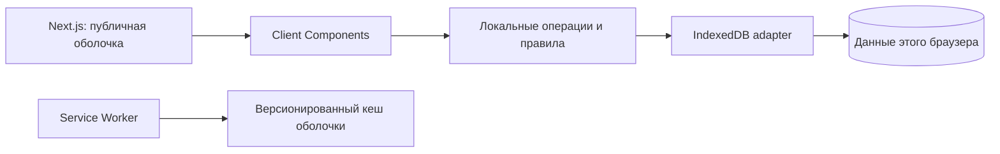

# TaskTracker: актуальная архитектура

Решение обновлено 29 октября 2026 года по запросу владельца продукта: glassmorphism-интерфейс, local-first режим без серверной регистрации и расширение облачной части отдельными сервисами.

## Текущий продукт

Next.js выдаёт публичную оболочку приложения. Страницы и root layout остаются Server Components; локальное пространство, формы, работа с IndexedDB, service worker и обработчик движения указателя — небольшие Client Components. CSS-анимации работают без React-рендеров; reduced-motion отключает движение, на touch-устройствах pointer-параллакс не включается.

Локальное пространство — профиль устройства, а не проверенная сервером личность. Здесь нет пароля, серверной сессии или обещания защиты от другого человека с доступом к этому же профилю браузера.

Разделение кода: `features/local/contracts.ts` — типы и ограничения; `store.ts` — транзакции и индексированные запросы; `entry.tsx` / `workspace.tsx` — UI. Компоненты не работают с object stores напрямую. Импорт браузерного состояния в серверную авторизацию запрещён.

## Данные и производительность

- IndexedDB хранит profile, projects и tasks. IndexedDB-транзакция атомарно изменяет задачу и агрегаты проекта.
- Список проектов читается по индексу updatedAt/id. Задачи читаются только для выбранного проекта и статуса по составным индексам; начальная порция — 50 записей. «Показать ещё» увеличивает ограничение. Это ограниченная прогрессивная загрузка; cursor pagination для больших наборов — следующий шаг.
- Счётчики taskCount/doneCount не требуют загрузки всех задач. version защищает от устаревшей записи в другой вкладке; BroadcastChannel обновляет представления между вкладками.
- Дедлайн — календарная дата. Техническое время — ISO UTC; completedAt сохраняется при повторном Done и очищается при возврате в работу.
- В Identity используются явные SQL-проекции: login читает id/email/password_hash, проверка сессии — id/email. Обе выборки ограничены одной записью; UNIQUE-индексы email и token_hash уже существуют. Тест наблюдает фактически выполняемый SELECT профиля и запрещает загрузку password_hash/created_at. Измерений высокой нагрузки и гарантий latency пока нет.

## Офлайн-оболочка и обновления

Service worker предзагружает публичные HTML `/login` и `/projects`, их JS/CSS chunks, manifest и иконки. `/api/*`, `/health/*` и данные пользователя не кешируются. Кеш именуется уникальным build id, чтобы HTML и chunks были одного релиза. Новая версия ждёт подтверждения «Обновить»; старый кеш удаляется при активации.

Работа без сети доступна после первого успешного открытия и завершения подготовки оболочки. Для PWA требуется secure context: localhost на компьютере либо HTTPS. На обычном HTTP по LAN service worker и установка на телефон недоступны. Данные принадлежат origin и профилю браузера; смена домена, другого браузера или устройства не переносит их. Очистка данных сайта удаляет локальные данные. Автоматической облачной синхронизации пока нет.

## Облачные сервисы: принятые границы

| Сервис | Владение | Состояние |
|---|---|---|
| Identity | пользователи, пароли, opaque sessions, лимиты входа; собственная БД и миграции | существующий FastAPI backend, запускается профилем cloud |
| Workspace | серверные проекты/задачи, владелец, версии, журнал синхронизации; отдельная БД и миграции | запланирован, ещё не реализован |

Workspace не добавляется внутрь Identity. При реализации это отдельное приложение, процесс, health endpoints, OpenAPI и release job. User id передаётся как внешняя ссылка, без cross-service SQL joins и FK в таблицы Identity. Проверка credential — контракт Identity; браузерный profile id не доказывает права на облачные данные. Синхронизация первоначально принадлежит Workspace: idempotent change ids, expected_version, журнал изменений и явное разрешение конфликтов. Отдельный Sync-сервис добавляется при самостоятельной нагрузке/жизненном цикле, а не заранее.

Текущий локальный режим не требует этих сервисов. Compose по умолчанию запускает frontend; `--profile cloud` дополнительно включает Identity/PostgreSQL/migrations. План сервисов не означает, что Workspace уже выделен или синхронизация работает.

## Порядок дальнейшей работы

1. Локальные проекты/задачи, PWA и адаптивный glass-интерфейс: реализованы базовые сценарии, проверяются тестами.
2. Редактирование, архив, описание задач, переносимый backup/import, поиск и cursor pagination.
3. Отдельный Workspace service и его HTTP-контракт; права проверяются на сервере.
4. Добровольное подключение облачного аккаунта, синхронизация с конфликтами и независимый деплой сервисов.
5. Публичный HTTPS, proxy limits, backup/restore и эксплуатационные проверки.

[Исходный облачный план](cloud-plan.md) сохранён для требований к версиям, правам и транзакциям. Его монолитная схема и запрет offline-first заменены этим решением. Наличие исторического пункта в документе не означает его реализацию.
