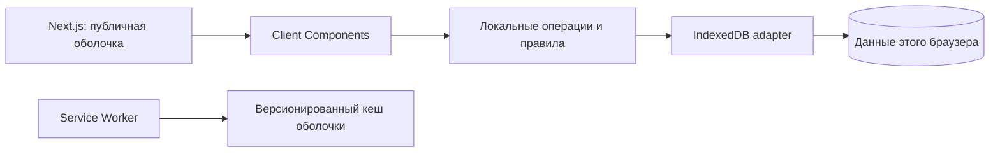

# TaskTracker: актуальная архитектура

Решение обновлено 29 октября 2026 года по запросу владельца продукта: glassmorphism-интерфейс, local-first режим без серверной регистрации и расширение облачной части отдельными сервисами.

## Текущий продукт

UI следует минимализму: короткие заголовки и действия, без слоганов, приветственных абзацев и повторяющихся пояснений. Второстепенные сведения раскрываются по запросу; подписи для доступности сохраняются.

Язык интерфейса — английский. Две гарнитуры: Plus Jakarta Sans для заголовков и бренда, Inter для основного текста и форм. Файлы шрифтов поставляются локально, предзагружаются и входят в кеш PWA; Google Fonts в браузере не вызывается. Inter также отображает кириллические пользовательские данные без их изменения.

Next.js выдаёт публичную оболочку приложения. Страницы и root layout остаются Server Components; локальное пространство, формы, работа с IndexedDB, service worker и обработчик движения указателя — небольшие Client Components. CSS-анимации работают без React-рендеров; reduced-motion отключает движение, на touch-устройствах pointer-параллакс не включается.

Локальное пространство — профиль устройства, а не проверенная сервером личность. Здесь нет пароля, серверной сессии или обещания защиты от другого человека с доступом к этому же профилю браузера.

Разделение кода: `features/local/contracts.ts` — типы и ограничения; `store.ts` — транзакции и индексированные запросы; `entry.tsx` / `workspace.tsx` — UI. Компоненты не работают с object stores напрямую. Импорт браузерного состояния в серверную авторизацию запрещён.

Навигация проектов и представление прогресса выделены в `project-navigation.tsx`
и `project-progress.tsx`. Они получают данные через props и не читают IndexedDB.
`TaskChange` различает сохранение, перенос и удаление, поэтому UI не подменяет
результат переноса выбранным статусом. `moveTasks` возвращает фактическое число
переносов только после commit; same-project записи не изменяются и не увеличивают
этот счётчик. Проверки всех версий и обновления агрегатов остаются в одной транзакции.

`task-card.tsx` только показывает задачу и вызывает открытие редактора. Общий
`shared/ui/modal.tsx` отвечает за native dialog, top layer и блокировку фонового
скролла; доменных операций и IndexedDB в нём нет. `task-editor.tsx` сохраняет
название/дату/статус одной существующей операцией `editTask` с expected version
и атомарным завершением черновика. Переход от inline-формы к диалогу не меняет
схему хранения и контракт backup.

## Данные и производительность

- IndexedDB v3 хранит profile, projects, tasks и drafts. Миграция v1→v2 добавляет drafts и индекс projectId/updatedAt/id; v2→v3 добавляет индекс state/updatedAt/id и заполняет state/version проектов; существующие записи не пересоздаются. IndexedDB-транзакция атомарно изменяет задачу, агрегаты проекта и удаляет использованный черновик (либо сохраняет оставшийся текст другого режима).
- Список проектов читается по индексу updatedAt/id. Задачи читаются только для выбранного проекта и статуса по составным индексам: по 50 совпадений со строгим курсором createdAt/id. Поиск/дедлайн проверяются в пределах не более 500 записей за запрос; More tasks продолжает с последней просмотренной записи, не перечитывая начало. После изменения данных выдача начинается заново. Проекты загружаются ограниченными порциями; выбранный проект удерживается прямым lookup даже вне первой порции.
- Счётчики taskCount/doneCount не требуют загрузки всех задач. version защищает от устаревшей записи в другой вкладке; BroadcastChannel обновляет представления между вкладками.
- Дедлайн — календарная дата. Техническое время — ISO UTC; completedAt сохраняется при повторном Done и очищается при возврате в работу.
- Черновики проектов, single/batch-создания и редактирования сохраняются отдельно от задач. DraftController сериализует записи и сохраняет последний снимок без обновления списков задач на каждую клавишу: уведомления drafts отделены от workspace. Запись черновика использует expected version; конфликт разрешается отдельной копией, без перезаписи чужого текста. Редактор хранит исходный Task/version, поэтому восстановление не снимает проверку конфликта задачи.
- SessionStorage хранит только указатели на черновики и выбранный проект/фильтр. Текст находится в IndexedDB; Saved drafts / Project drafts позволяют восстановиться и из новой вкладки. После отказа записи последний текст остаётся в контроллере в памяти страницы; beforeunload предупреждает о незаписанных изменениях. Update сначала ждёт flush. Принудительное завершение браузера/ОС при отказе хранилища этим не покрывается.
- JSON backup включает подтверждённые проекты и задачи, но не незавершённые черновики. Очистка данных сайта удаляет и черновики. Автоматический откат базы v3→v2/v1 не поддерживается: при откате приложения нужно сохранять совместимость чтения схемы v3.
- В Identity используются явные SQL-проекции: login читает id/email/password_hash, проверка сессии — id/email. Обе выборки ограничены одной записью; UNIQUE-индексы email и token_hash уже существуют. Тест наблюдает фактически выполняемый SELECT профиля и запрещает загрузку password_hash/created_at. Измерений высокой нагрузки и гарантий latency пока нет.

## Офлайн-оболочка и обновления

Service worker предзагружает публичные HTML `/login` и `/projects`, их JS/CSS chunks, manifest и иконки. `/api/*`, `/health/*` и данные пользователя не кешируются. Кеш именуется уникальным build id, чтобы HTML и chunks были одного релиза. Новая версия ждёт подтверждения «Обновить»; старый кеш удаляется при активации.

Подготовка вынесена в `shared/pwa/offline-shell.ts`, React-компонент только
показывает состояние и обрабатывает подтверждение обновления. Готовность требует
активированного worker и фактического controller страницы. Не используется
глобальный `serviceWorker.ready`, который не отклоняется после провала установки.
Если первичная установка стала redundant, модуль один раз регистрирует тот же
build заново; обе попытки и получение управления входят в общий бюджет 25 секунд.
Каждая новая установка получает отдельный cache id в URL worker; повторное открытие
той же сборки сохраняет URL уже устанавливаемого/активного worker. Неудачная попытка
не пишет в кеш следующей. Перед завершением install проверяются все страницы и
assets; старые кеши удаляются только при активации полностью подготовленной версии.
При постоянном отказе остаётся явный Retry. AbortSignal снимает ожидания/слушатели
при навигации. Уже активный worker обслуживает офлайн без выдуманного fallback
build id; ожидающее обновление не активируется автоматически.

Работа без сети доступна после первого успешного открытия и завершения подготовки оболочки. Для PWA требуется secure context: localhost на компьютере либо HTTPS. На обычном HTTP по LAN service worker и установка на телефон недоступны. Данные принадлежат origin и профилю браузера; смена домена, другого браузера или устройства не переносит их. Очистка данных сайта удаляет локальные данные. Автоматической облачной синхронизации пока нет.

## Облачные сервисы: принятые границы

| Сервис | Владение | Состояние |
|---|---|---|
| Identity | пользователи, пароли, opaque sessions, лимиты входа; собственная БД и миграции | существующий FastAPI backend, запускается профилем cloud |
| Workspace | серверные проекты/задачи, владелец, версии, журнал синхронизации; отдельная БД и миграции | запланирован, ещё не реализован |

Workspace не добавляется внутрь Identity. При реализации это отдельное приложение, процесс, health endpoints, OpenAPI и release job. User id передаётся как внешняя ссылка, без cross-service SQL joins и FK в таблицы Identity. Проверка credential — контракт Identity; браузерный profile id не доказывает права на облачные данные. Синхронизация первоначально принадлежит Workspace: idempotent change ids, expected_version, журнал изменений и явное разрешение конфликтов. Отдельный Sync-сервис добавляется при самостоятельной нагрузке/жизненном цикле, а не заранее.

Текущий локальный режим не требует этих сервисов. Compose по умолчанию запускает frontend; `--profile cloud` дополнительно включает Identity/PostgreSQL/migrations. План сервисов не означает, что Workspace уже выделен или синхронизация работает.

## Telegram Mini App

По решению владельца от 11 ноября 2026 установка PWA на физический Android
исключена из обязательной приёмки; выбран запуск через `@TaskTrackerPetBot`.
Первая версия — bot menu launcher существующего HTTPS frontend. Настройка Bot API
вынесена в одноразовый `scripts/telegram-menu.mjs`; отдельный постоянно работающий
бот, webhook или polling пока не требуются. Токен находится вне frontend и Docker
context в игнорируемом локальном env-файле. Скрипт не отправляет сообщения в чаты.

Telegram Web открывает приложение в iframe: CSP разрешает только официальный
`https://web.telegram.org` для `/login` и `/projects`, остальные ответы запрещают
встраивание. UI/IndexedDB не зависят от Telegram SDK или initDataUnsafe. Локальный
профиль не стал Telegram-аутентификацией; данные WebView могут отличаться от данных
обычного браузера. Будущая серверная интеграция должна проверять signed initData
на сервере и оставаться отдельным адаптером, без обхода контрактов Identity/Workspace.

## Порядок дальнейшей работы

1. Локальные проекты/задачи, PWA и адаптивный glass-интерфейс: реализованы базовые сценарии, проверяются тестами.
2. Редактирование названия, дедлайна и статуса реализовано в общем диалоге задачи: expected version, защита от конфликтов вкладок. Также реализованы пакетное добавление и групповые операции, подтверждение удаления, переносимый backup/import копиями. Также реализованы архив/восстановление, переименование, описания, переносы, поиск и cursor pagination. Публичная приёмка — по release.md.
3. Отдельный Workspace service и его HTTP-контракт; права проверяются на сервере.
4. Добровольное подключение облачного аккаунта, синхронизация с конфликтами и независимый деплой сервисов.
5. Публичный HTTPS, proxy limits, backup/restore и эксплуатационные проверки.

[Исходный облачный план](cloud-plan.md) сохранён для требований к версиям, правам и транзакциям. Его монолитная схема и запрет offline-first заменены этим решением. Наличие исторического пункта в документе не означает его реализацию.

Матрица пользовательских сценариев и критерии публичного релиза: [release-readiness.md](release-readiness.md).

Архив — состояние проекта без удаления данных; задачи архивного проекта доступны для чтения. Перенос/редактирование/создание в архиве запрещены транзакцией. Перенос и возможная смена статуса пересчитывают счётчики источника и получателя атомарно; технические даты задачи сохраняются. Метаданные проекта имеют отдельную version, не увеличиваемую при обычной правке задач. Backup v2 сохраняет state/description, v1 принимается с безопасными значениями по умолчанию.
